# osTicket – Prerequisites and Installation

## Project Overview

This project demonstrates the installation and initial setup of osTicket, an open-source help desk ticketing system, using a Windows virtual machine hosted in Microsoft Azure.

The purpose of this lab was to gain hands-on experience installing and configuring the software components required to operate a help desk ticketing system.

This project is Part 1 of a three-part osTicket lab series.

## Environments and Technologies Used

- Microsoft Azure (Virtual Machines)
- Remote Desktop Protocol (RDP)
- Windows 10
- Internet Information Services (IIS)
- PHP and PHP Manager
- MySQL Database
- HeidiSQL
- osTicket

## Operating System Used

- Windows 10

## List of Prerequisites

The following components were required to complete the installation:

1. Microsoft Azure virtual machine
2. Remote Desktop connection
3. Internet Information Services (IIS)
4. PHP and required PHP extensions
5. PHP Manager for IIS
6. MySQL database server
7. HeidiSQL database management application
8. osTicket installation files

---

# Installation Steps

## Step 1: Create the Azure Virtual Machine

Created a Windows virtual machine in Microsoft Azure to host the osTicket help desk application.

The virtual machine provided the Windows environment needed to install IIS, PHP, MySQL, and osTicket.

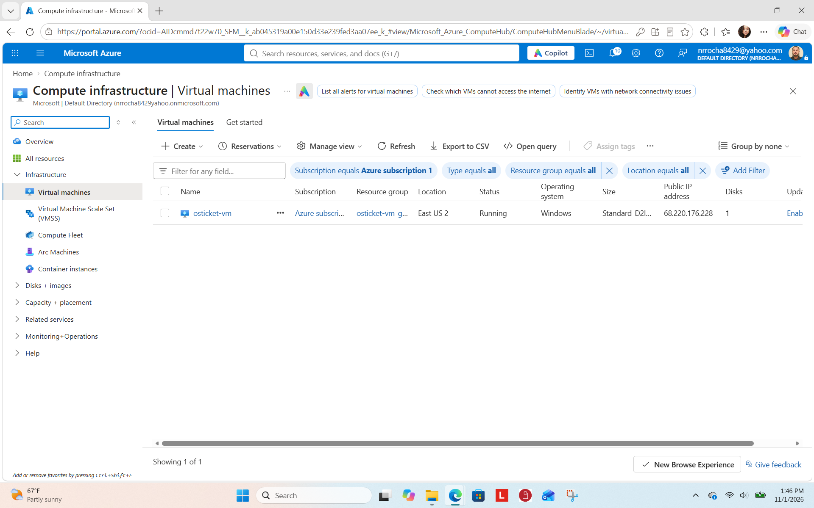

## Step 2: Verify the Windows Environment

Connected to the virtual machine using Remote Desktop and verified access to the Windows command-line environment.

This confirmed that the virtual machine was accessible and ready for software installation.

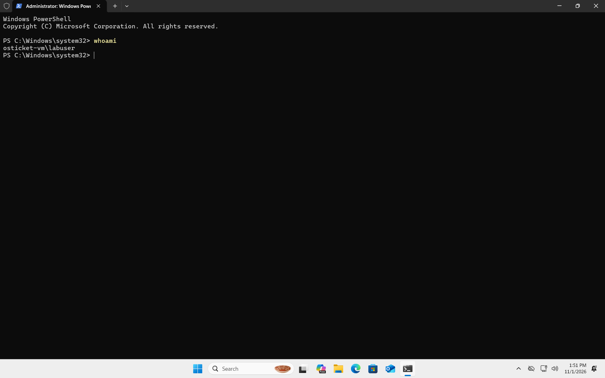

## Step 3: Prepare the Windows Virtual Machine

Reviewed the Windows environment and prepared the system for the installation of the required web server and database components.

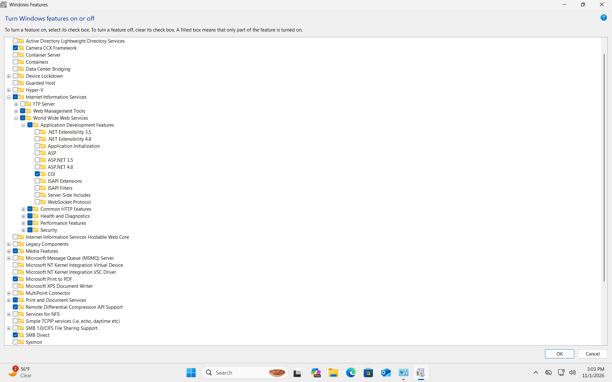

## Step 4: Prepare the Installation Files

Downloaded and organized the software packages required to install osTicket.

These included the IIS-related components, PHP, MySQL, and osTicket application files.

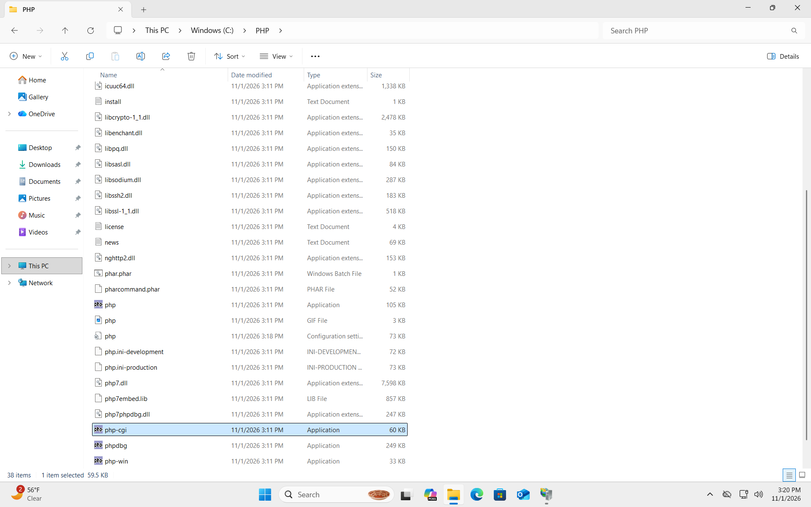

## Step 5: Verify the MySQL Database Service

Opened Windows Services and confirmed that the MySQL database service was running.

MySQL provides the database services required for osTicket to store tickets, user accounts, and application settings.

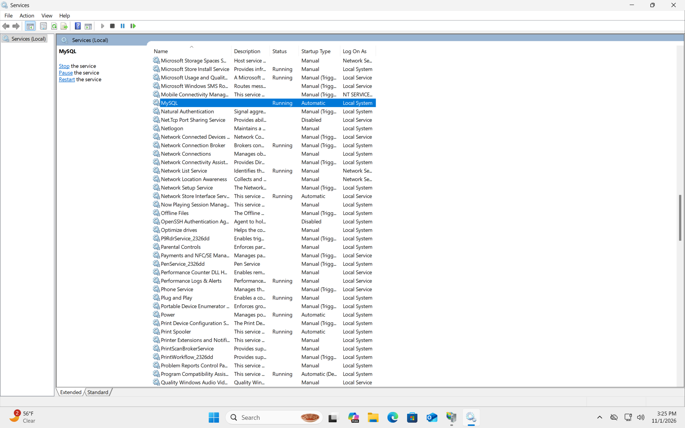

## Step 6: Configure PHP Manager

Used PHP Manager to configure PHP integration with IIS.

PHP is required because osTicket is a PHP-based application.

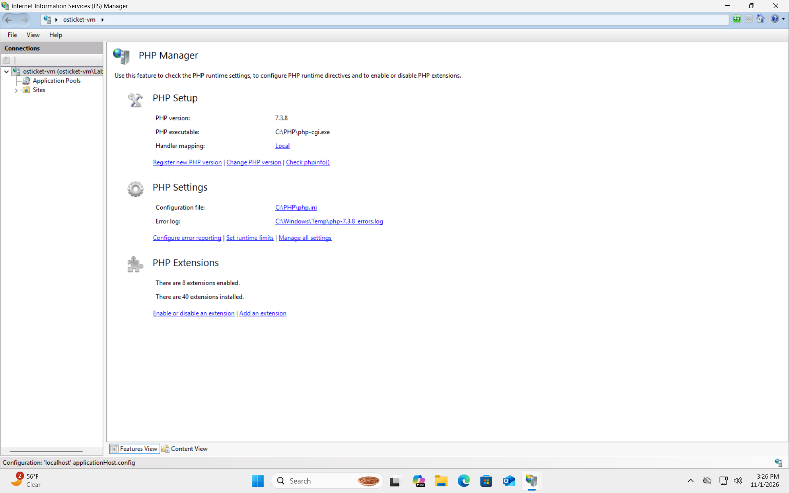

## Step 7: Configure the osTicket Web Directory

Placed the osTicket application files into the appropriate IIS web directory.

This allows IIS to locate and serve the osTicket application through a browser.

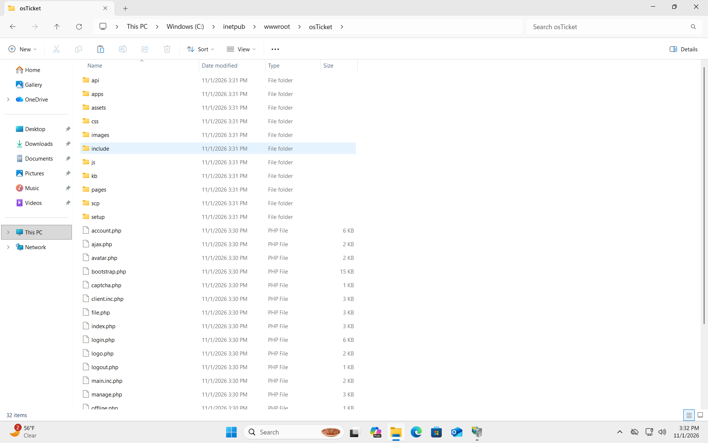

## Step 8: Verify Installation Prerequisites

Opened the osTicket installation page and reviewed the prerequisite checks.

The installer checks whether the necessary PHP components and server requirements are available.

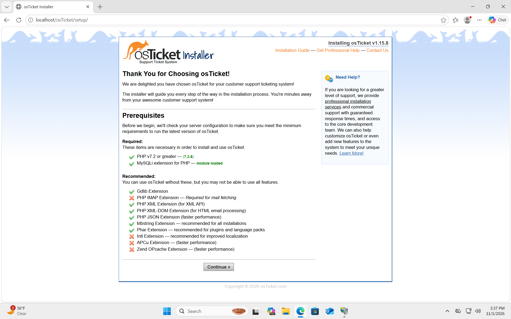

## Step 9: Configure PHP Extensions

Reviewed and enabled the PHP extensions required by osTicket.

These extensions allow the application to perform functions such as database communication and other server-side operations.

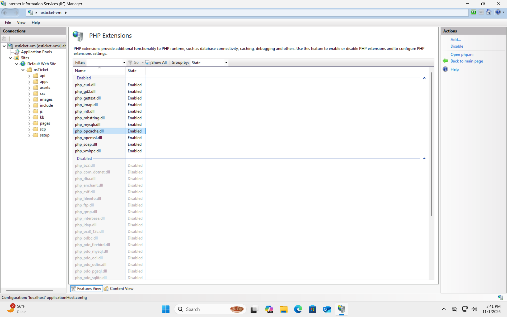

## Step 10: Verify Installer Readiness

Returned to the osTicket installer to confirm that the necessary installation requirements were satisfied.

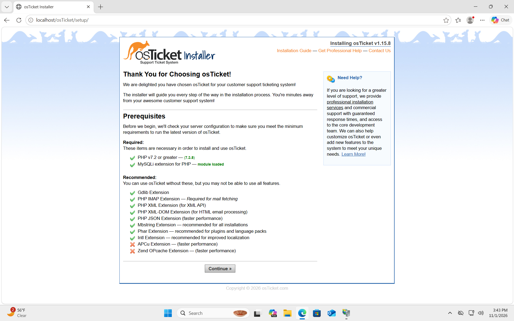

## Step 11: Configure Installation File Permissions

Configured the osTicket configuration file and adjusted its permissions so the installer could write the required settings.

The configuration file stores important application settings, including database connection information.

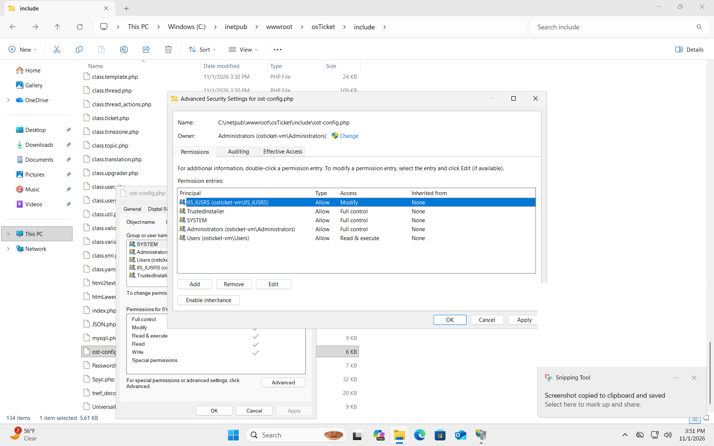

## Step 12: Complete the Basic Installation Form

Entered the required information into the osTicket installation form.

The installation process included configuring the help desk information, administrator account, and database connection settings.

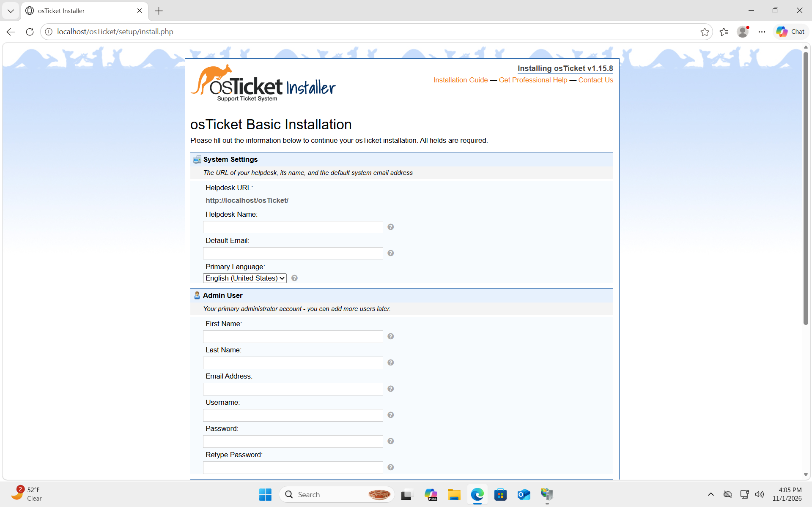

## Step 13: Configure the MySQL Database

Used the database management environment to prepare and verify the database required by osTicket.

The database stores help desk information such as users, agents, tickets, and application settings.

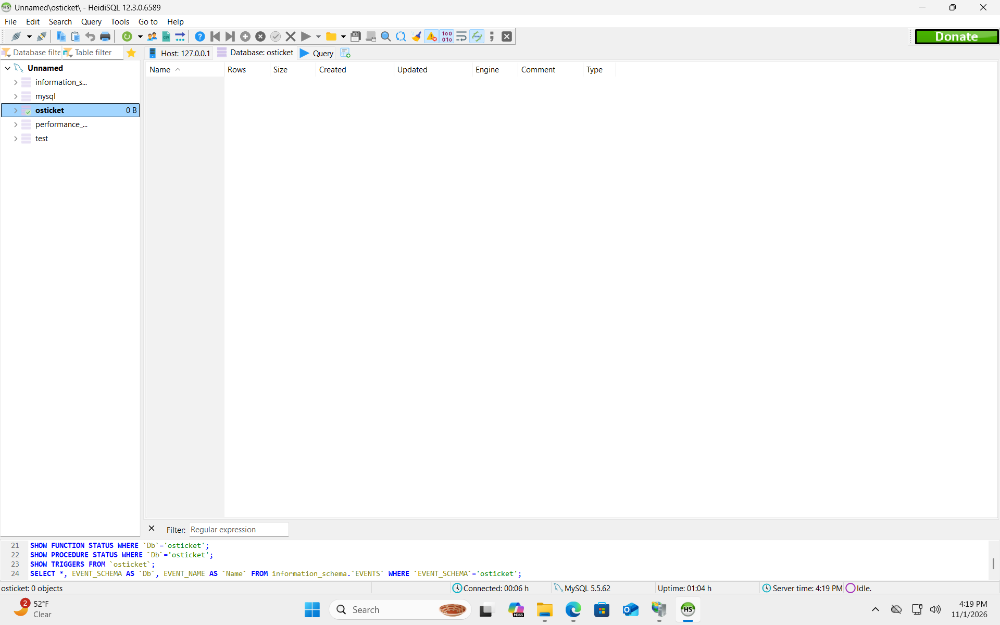

## Step 14: Verify Successful Installation

Completed the installation process and verified that osTicket displayed its successful installation confirmation.

This confirmed that the application was installed and ready for post-installation configuration.

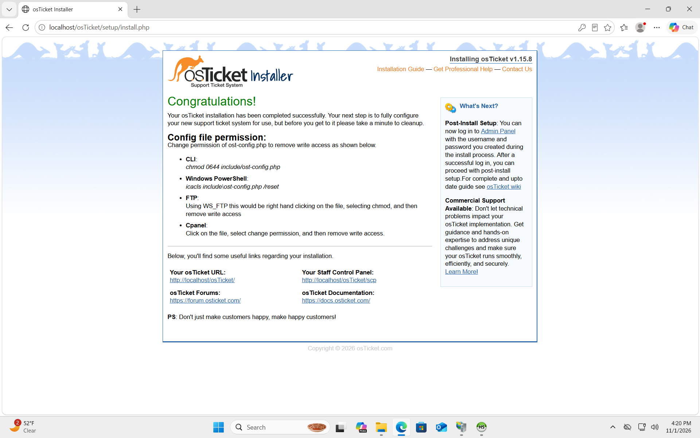

---

# Skills Demonstrated

Through this project, I gained hands-on experience with:

- Creating and accessing virtual machines in Microsoft Azure
- Connecting to remote Windows systems using RDP
- Installing and configuring IIS
- Configuring PHP and required extensions
- Preparing MySQL database services
- Managing application configuration files and permissions
- Installing a web-based help desk ticketing system
- Verifying successful application deployment
- Documenting technical procedures with screenshots

---

# Project Outcome

Successfully installed osTicket in a Microsoft Azure-hosted Windows environment.

This project provided practical experience with web server configuration, application deployment, database connectivity, and troubleshooting installation requirements.

The completed installation provides the foundation for configuring help desk departments, agents, users, SLA plans, and ticket workflows.

## Next Project

**Part 2: osTicket – Post-Installation Configuration**

The next lab focuses on configuring the osTicket help desk environment, including departments, teams, agents, users, help topics, and SLA plans.
